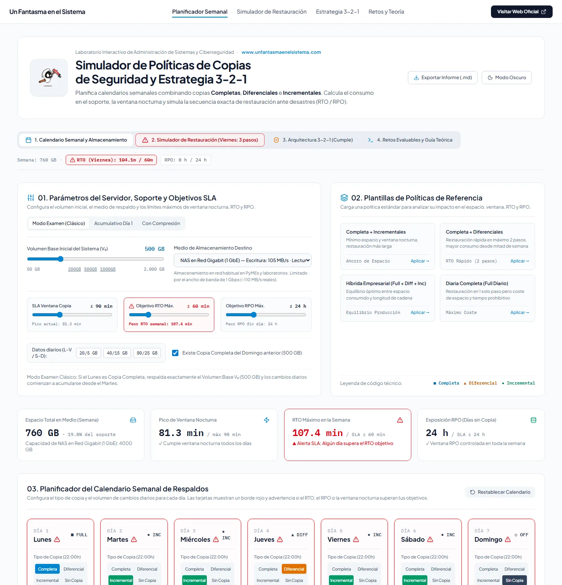
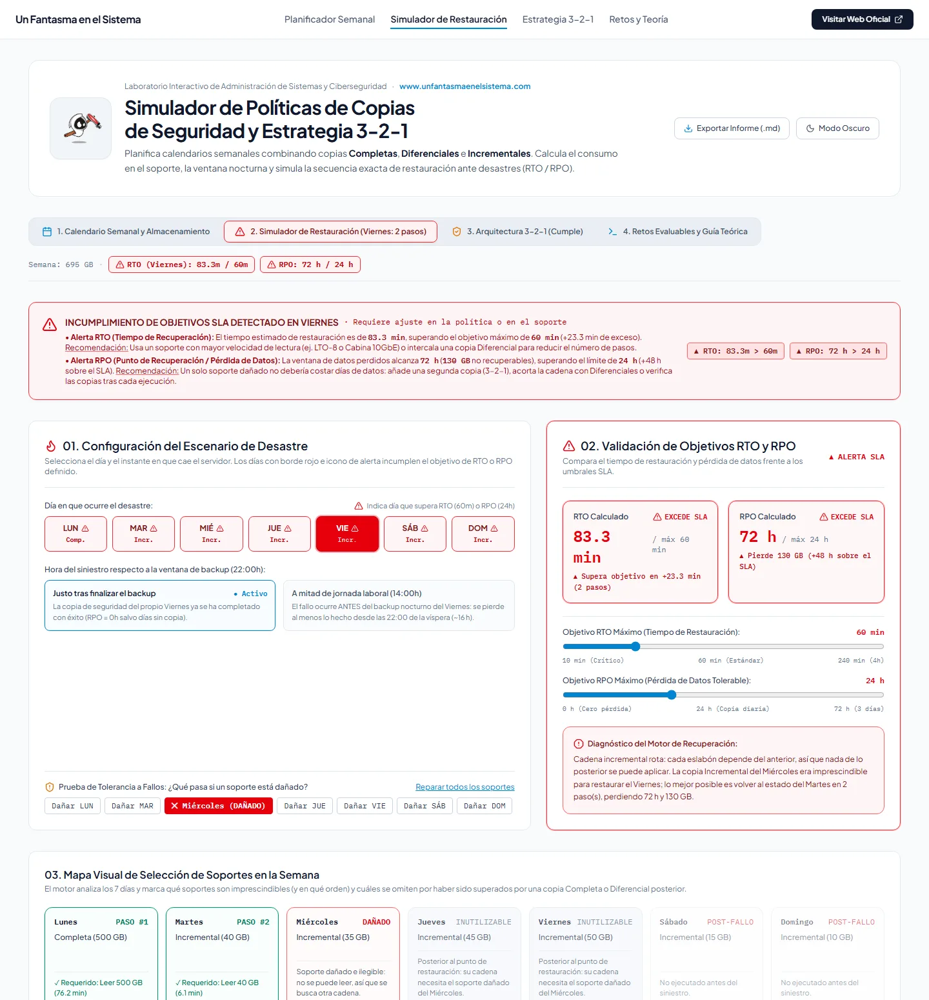
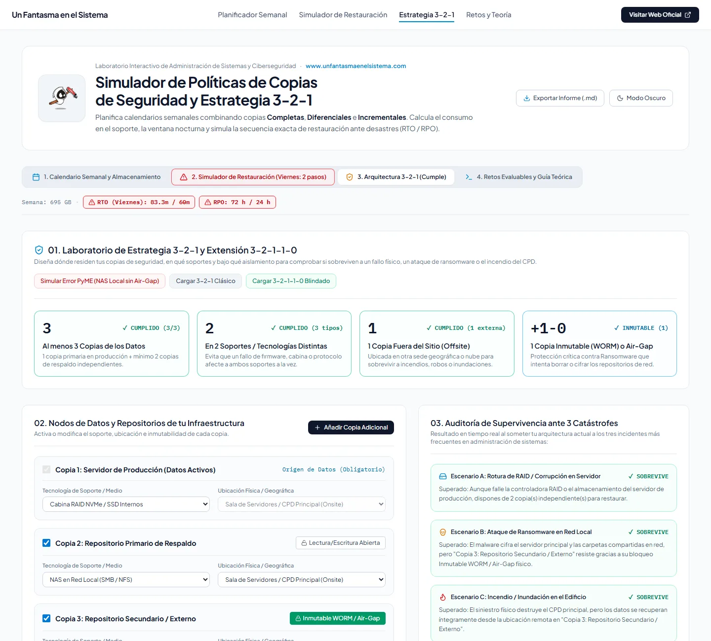
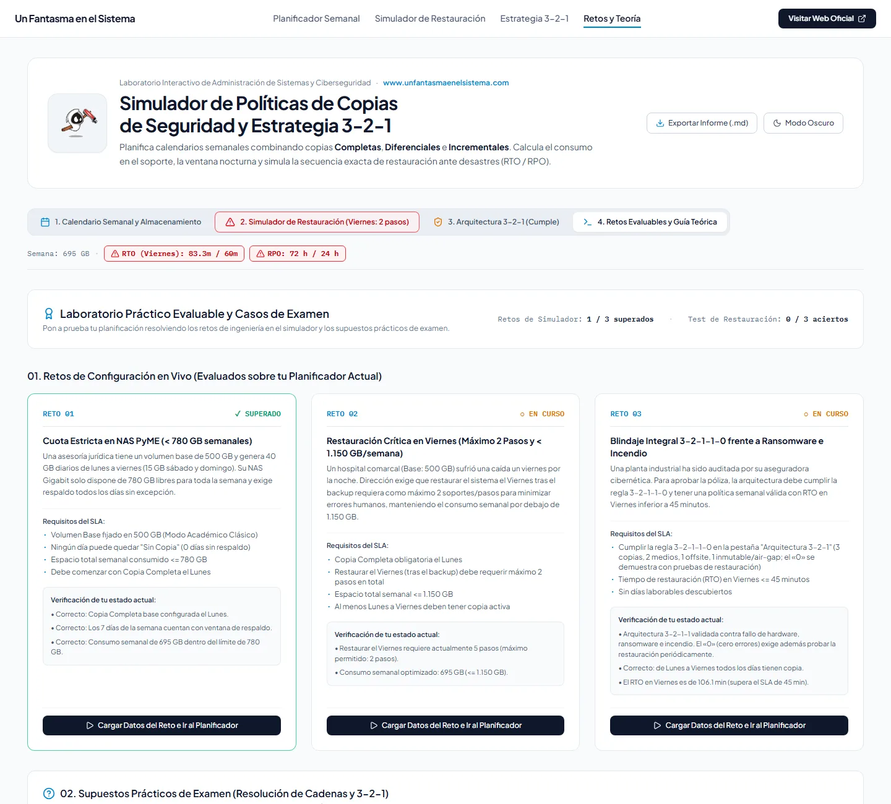

<p align="center">
  <a href="https://www.unfantasmaenelsistema.com"></a>
</p>

<h1 align="center">Simulador de Políticas de Copias de Seguridad</h1>

<p align="center">
  <b>Planifica una semana de copias Completas, Diferenciales e Incrementales y comprueba qué pasa el día del desastre</b><br>
  Espacio y ventana nocturna · Secuencia exacta de restauración · RTO y RPO · Soportes dañados · Regla 3-2-1-1-0 · Retos evaluables
</p>

<p align="center">
  <a href="https://unfantasmaenelsistema.github.io/Simulador-de-Politicas-Copias-de-Seguridad/"><b>▶ Abrir el simulador</b></a> ·
  <a href="#qué-hace">Qué hace</a> ·
  <a href="#cómo-calcula">Cómo calcula</a> ·
  <a href="#retos-y-examen">Retos</a> ·
  <a href="#desarrollo">Desarrollo</a> ·
  <a href="https://www.unfantasmaenelsistema.com">unfantasmaenelsistema.com</a> ·
  <a href="LICENSE">MIT</a>
</p>

<p align="center">
  
  
  
  
</p>

<p align="center">
  
</p>

Eliges el volumen del servidor, los cambios de cada día, el soporte (NAS, cabina 10 GbE, cinta LTO-8, disco USB o nube) y el tipo de copia de cada noche. El simulador calcula lo que ocupa cada conjunto, cuánto tarda la ventana nocturna y, para cualquier día y hora del desastre, qué soportes hay que cargar y en qué orden, cuánto se tarda en volver a estar en marcha (RTO) y cuántos datos se pierden (RPO).

## Qué hace

- **Planificador semanal** con cuatro plantillas (Completa + Incrementales, Completa + Diferenciales, híbrida y Completa diaria), gráfico de consumo y comparativa automática de las cuatro políticas con tus mismos datos.
- **Simulador de restauración**: elige el día y si el siniestro llega a mitad de jornada (14:00) o justo después del backup (22:00). Muestra el runbook paso a paso, las copias que se omiten y por qué, y avisa si se superan los objetivos de RTO y RPO.
- **Soportes dañados**: marca cualquier copia como ilegible y el motor busca el punto más reciente que todavía se puede restaurar sin ella. Con diferenciales, una cinta intermedia dañada no cuesta nada; con incrementales, rompe la cadena desde ese día; con una Completa diaria basta con volver al día anterior.
- **Arquitectura 3-2-1-1-0**: copias, medios, ubicación e inmutabilidad (WORM o air-gap) frente a tres siniestros: avería del servidor, ransomware con credenciales de dominio e incendio del CPD.
- **Retos y teoría**: tres retos con corrección automática, tres preguntas de examen con explicación y un cuadro comparativo de los tres tipos de copia.
- Informe en Markdown para entregar la práctica y modo oscuro.

<p align="center">
  
</p>

## Cómo calcula

- **Diferencial** = cambios desde la última Completa; **Incremental** = cambios desde la copia anterior, sea del tipo que sea. Es el modelo de catálogo del software actual (Veeam, Bacula, Acronis…). Con el bit de archivo clásico (`xcopy /m`, `robocopy /m`) una Diferencial hecha tras varias Incrementales solo recogería lo cambiado desde la última Incremental; la guía teórica lo explica.
- **Modo examen clásico**: si el lunes hay Completa, copia exactamente el volumen base y los cambios se acumulan desde el martes. Los otros modos incluyen los cambios del lunes o aplican un factor de compresión y deduplicación.
- **Tiempo** = GB × 1024 / MB/s del soporte. El tiempo de restauración suma la lectura de cada conjunto y el montaje de cada soporte adicional (3,5 min en cinta, 1 min en disco o nube).
- **RPO** = tiempo entre el último punto que se puede restaurar y el siniestro. Un día «Sin copia» solo suma pérdida si queda después de ese punto; si después hay una copia, sus cambios ya van dentro.

<p align="center">
  
</p>

## Retos y examen

| Reto | Condiciones |
| :-: | :-- |
| 01 · Cuota en NAS de PyME | Copia los 7 días, Completa el lunes y menos de 780 GB en la semana |
| 02 · Restauración del viernes | Lunes a viernes con copia, restaurar el viernes en 2 pasos como máximo y menos de 1.150 GB |
| 03 · Auditoría 3-2-1-1-0 | Arquitectura con copia externa e inmutable, lunes a viernes con copia y restauración del viernes en menos de 45 min |

Las pruebas automáticas aplican la solución de cada pista y comprueban que aprueba, y también que las soluciones tramposas (dejar laborables sin copia) no lo hacen.

<p align="center">
  
</p>

## Privacidad

Todo se ejecuta en el navegador, sin servidor ni cuentas, y nada se guarda fuera de la pestaña. Las fuentes van incluidas en la web y una política CSP estricta impide cargar código o estilos de terceros.

## Desarrollo

Requisitos: Node.js 20 o superior.

```bash
git clone https://github.com/unfantasmaenelsistema/Simulador-de-Politicas-Copias-de-Seguridad.git
cd Simulador-de-Politicas-Copias-de-Seguridad
npm ci
npm run dev      # http://localhost:3000
npm test         # pruebas del motor y de los retos (Vitest)
npm run lint     # comprobación de tipos
npm run build    # versión estática en dist/
```

El workflow `.github/workflows/deploy.yml` comprueba tipos, pasa las pruebas, compila y publica `dist/` en GitHub Pages en cada push a `main`.

```text
src/
├── data/backupEngine.ts       # tamaños, ventanas, cadenas de restauración, RTO/RPO y 3-2-1
├── data/challengesData.ts     # retos y preguntas de examen
├── data/backupEngine.test.ts  # pruebas (Vitest)
└── components/                # planificador, restauración, 3-2-1 y retos
```

## Cambios

### 2.0.0 (2026-11-02)

- Publicado en la organización con el nombre `Simulador-de-Politicas-Copias-de-Seguridad` (antes `Simulador-Pol-ticas-Copias-Seguridad`; la dirección antigua redirige). El workflow original no podía funcionar: `npm install` fallaba por un conflicto de versiones de `esbuild`.
- **Soportes dañados**: el motor solo marcaba el paso como corrupto y seguía sumando la cadena completa. Con una Completa dañada daba siempre pérdida total, aunque hubiera otra Completa anterior: con la política de Completa diaria, perder el jueves no permitía restaurar el miércoles. Ahora busca el punto más reciente cuya cadena no necesita el soporte dañado y calcula el RPO desde ahí.
- **RPO**: las 16 h del lunes estaban fijas en el código, y cualquier día «Sin copia» anterior al siniestro se marcaba con +24 h aunque sus cambios ya estuvieran en una copia posterior. Cuando no había nada que restaurar se mostraban «999 h»; ahora pone «pérdida total».
- **Retos**: el 02 y el 03 exigían copia de lunes a viernes, pero no lo comprobaban. En el examen, la opción de cuatro pasos del caso 2 sumaba 885 GB; son 785.
- **Teoría**: las fórmulas hablaban del bit de archivo mientras el motor usa el modelo de catálogo, y con el bit de archivo la política híbrida no funciona igual. Ahora se explica la diferencia, y se distingue el RTO y el RPO (objetivos) del tiempo y la pérdida calculados.
- **Interfaz**: la cabecera, el selector de soporte, los grupos de botones y la rejilla de días desbordaban en móvil; los botones «Incremental» se recortaban en escritorio. Fuentes incluidas en la web en lugar de Google Fonts, CSP estricta, capturas reales en lugar de dibujos SVG, fuera dependencias de Gemini y Express que no se usaban, y 24 pruebas automáticas.

### 1.0.0

- Versión inicial generada con Google AI Studio.

## Créditos y licencia

Creado por **[Un Fantasma en el Sistema](https://www.unfantasmaenelsistema.com)** para los módulos de seguridad informática y administración de sistemas de FP. Gráficos con Recharts (MIT); fuentes Plus Jakarta Sans e IBM Plex Mono (SIL Open Font License) vía Fontsource; iconos de Lucide (ISC).

Código bajo licencia [MIT](LICENSE).
