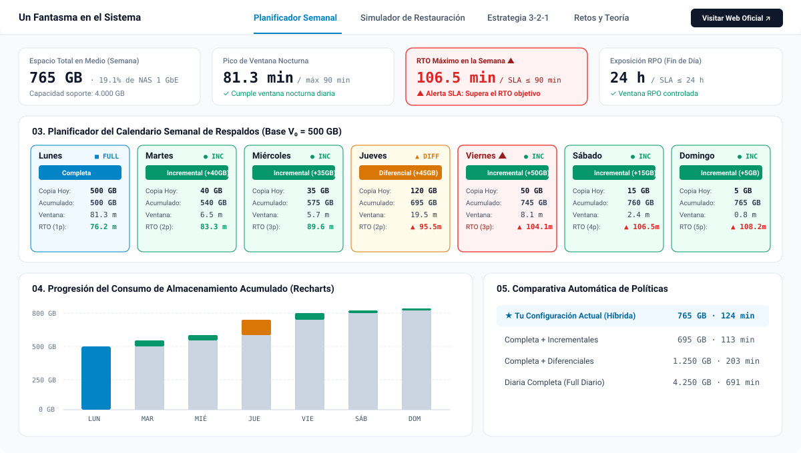
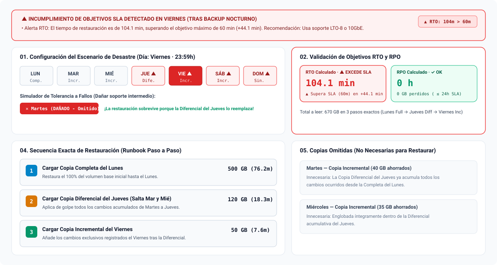
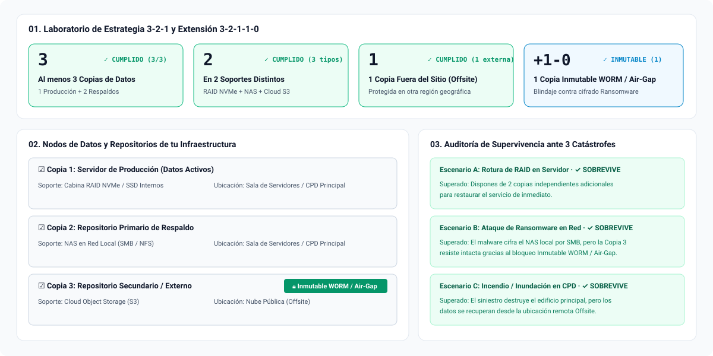
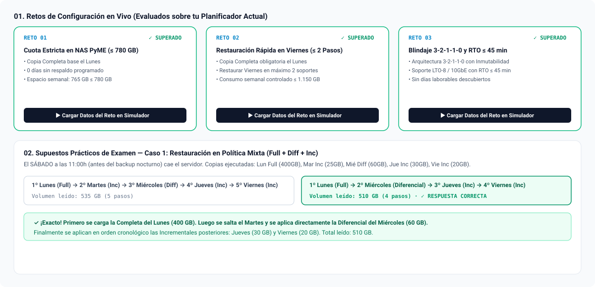

<div align="center">
  <a href="https://www.unfantasmaenelsistema.com/" target="_blank" rel="noopener noreferrer">
    
  </a>

  # Simulador de Políticas de Copias de Seguridad y Estrategia 3-2-1

  **Laboratorio interactivo de planificación de respaldos (Completas, Diferenciales e Incrementales), validación SLA (RTO / RPO), recuperación ante desastres y arquitectura 3-2-1-1-0.**

  Creado por **[Un Fantasma en el Sistema](https://www.unfantasmaenelsistema.com/)** · Recurso didáctico para Formación Profesional (SMR, ASIR, DAW, DAM), Especialización en Ciberseguridad e Ingeniería Informática.

  [](https://www.unfantasmaenelsistema.com/)
  [](https://react.dev/)
  [](https://www.typescriptlang.org/)
  [](https://tailwindcss.com/)
  [](https://pages.github.com/)
</div>

---

## 📋 ¿Qué hace esta aplicación?

El **Simulador de Políticas de Copias de Seguridad (Estrategia 3-2-1)** es una herramienta educativa e interactiva que permite a los alumnos y administradores de sistemas diseñar, auditar y poner a prueba estrategias de respaldo reales sin necesidad de infraestructura física:

1. **Configurar un calendario semanal (Lunes a Domingo)** combinando copias **Completas (*Full*)**, **Diferenciales (*Differential*)**, **Incrementales (*Incremental*)** o días sin copia.
2. **Calcular en tiempo real** el espacio consumido en el soporte cada noche, el almacenamiento acumulado semanal y la duración exacta de la ventana de backup según el soporte físico elegido (**NAS 1 GbE**, **Cabina SAN/NAS 10 GbE**, **Librería de Cintas LTO-8**, **Disco USB 3.2 / RDX** o **Repositorio Cloud S3**).
3. **Validar visualmente los acuerdos de nivel de servicio (SLA)**: muestra alertas automáticas con bordes rojos e iconos de advertencia si el **RTO** (*Recovery Time Objective*), el **RPO** (*Recovery Point Objective*) o la **ventana nocturna** superan los umbrales definidos.
4. **Simular un desastre en cualquier día y hora** para obtener el *Runbook* paso a paso con el orden cronológico exacto de soportes que deben cargarse y qué copias intermedias se descartan.
5. **Auditar arquitecturas bajo la regla 3-2-1 y 3-2-1-1-0** sometiéndolas a tres siniestros reales: rotura de RAID en producción, ataque de **Ransomware en red local** e **incendio/inundación en el CPD**.

---

## 📸 Capturas de Pantalla de los Módulos

### 1. Planificador Semanal, Alertas SLA y Gráfico de Progresión (`Recharts`)
Configura el volumen inicial ($V_0$), el soporte de destino, los objetivos máximos de **RTO / RPO** y el tipo de respaldo de cada día. Incluye visualización interactiva con **`recharts`** (*Escalera Acumulada Apilada* y *Comparativa Agrupada*) y tabla comparativa frente a las políticas canónicas.



---

### 2. Simulador de Restauración Paso a Paso y Tolerancia a Soportes Corruptos
Selecciona el día del fallo y si el incidente ocurre *antes* o *después* de la ventana nocturna de copia. El motor calcula la secuencia exacta de soportes a montar, las copias omitidas por haber sido englobadas en una copia Diferencial o Completa posterior, y permite **simular la rotura física de una cinta o archivo intermedio** para comprobar la fragilidad de las cadenas incrementales frente a las diferenciales.



---

### 3. Laboratorio de Arquitectura 3-2-1 y Extensión 3-2-1-1-0
Configura los nodos de tu infraestructura (tecnología de soporte, ubicación física *Onsite/Offsite* y bloqueo de **Inmutabilidad WORM / Air-Gap**) y comprueba en vivo si tus datos sobreviven a un fallo de hardware, un ataque de ransomware con credenciales de dominio o un incendio en la sala de servidores.



---

### 4. Retos Evaluables de Ingeniería, Supuestos de Examen y Guía Teórica
Incluye **3 retos prácticos de laboratorio** que evalúan en tiempo real la configuración que el alumno haya diseñado en el planificador, **3 casos prácticos de examen autocorregibles** con explicación razonada, cuadro comparativo teórico y botón para **Exportar Informe Técnico en Markdown (`.md`)** listo para entregar en clase.



---

## 🧮 Mecánica Didáctica y Fórmulas del Motor

### Comportamiento del Bit de Archivo (*Archive Bit*) y Tipos de Respaldo

| Tipo de Copia | ¿Qué datos respalda? | Marca de Archivo (*Archive Bit*) | Pasos para Restaurar | Tolerancia a Fallo Intermedio |
| :--- | :--- | :---: | :---: | :--- |
| **Completa (*Full*)** | El **100%** de los datos del sistema en ese instante. | Lo pone a `0` (Desmarca) | **1 paso** (Solo la última Completa) | Totalmente independiente de copias anteriores. |
| **Diferencial** | Todos los cambios acumulados desde la **última Completa**. | **No** lo modifica (Sigue en `1`) | **Máximo 2 pasos** (Última Completa + Última Diferencial) | **Alta:** Si se daña una diferencial previa, la última diferencial ya incluye todos sus datos. |
| **Incremental** | Solo los cambios generados desde la **última copia de cualquier tipo**. | Lo pone a `0` (Desmarca) | **N pasos** (Última Completa + todas las Incrementales en orden) | **Baja (Frágil):** Si se corrompe un eslabón intermedio, se rompe la cadena desde ese día. |

### Modos de Cálculo Soportados
- **Modo Examen (Clásico):** Si el Lunes se programa una copia Completa, respalda exactamente el Volumen Base Inicial ($V_0$, p. ej. `500 GB`) y los incrementos diarios comienzan a contarse desde el Martes. Ideal para resolver problemas académicos en pizarra o examen.
- **Modo Acumulativo desde Día 1:** Considera que la copia del Lunes a las 22:00h ya incluye el volumen base más los datos generados durante la jornada del propio Lunes ($V_0 + \Delta_{\text{Lunes}}$).
- **Modo Ingeniería con Compresión / Deduplicación:** Permite aplicar un factor de reducción ajustable ($0.4\times\text{ a }1.0\times$) sobre el volumen bruto de cada conjunto.

### Fórmulas de Tiempo y SLA
- **Tiempo de Ventana de Copia / Lectura:**
  $$\text{Tiempo (min)} = \frac{\text{Volumen (GB)} \times 1024}{\text{Velocidad del Soporte (MB/s)} \times 60}$$
- **RTO (*Recovery Time Objective*):**
  $$\text{RTO} = \sum_{i=1}^{k} \text{Tiempo de Lectura}(\text{Paso}_i) + (k - 1) \times T_{\text{montaje}}$$
- **RPO (*Recovery Point Objective*):**
  $$\text{RPO} = t_{\text{desastre}} - t_{\text{último backup válido}}$$

---

## 🚀 Instalación y Ejecución en Local

Requisitos previos: **Node.js 18+** y **npm**.

```bash
# 1. Clonar el repositorio
git clone https://github.com/TU_USUARIO/simulador-politicas-backup-321.git
cd simulador-politicas-backup-321

# 2. Instalar dependencias
npm install

# 3. Iniciar el servidor de desarrollo (puerto 3000)
npm run dev
```

Para generar la compilación estática de producción (carpeta `dist/`):

```bash
npm run build
```

---

## 🌐 Despliegue Automático en GitHub Pages

El proyecto ya está configurado con rutas relativas (`base: './'` en `vite.config.ts`) y cuenta con el flujo de trabajo de GitHub Actions en `.github/workflows/deploy.yml`.

Para publicarlo gratis en **GitHub Pages**:

1. Sube este repositorio a tu cuenta de GitHub (rama `main` o `master`).
2. En tu repositorio de GitHub, ve a **Settings → Pages**.
3. En la sección **Build and deployment → Source**, selecciona **GitHub Actions**.
4. Al hacer `git push`, la acción **Deploy to GitHub Pages** compilará automáticamente la aplicación y la publicará en `https://TU_USUARIO.github.io/NOMBRE_DEL_REPO/`.

---

## 📁 Estructura del Proyecto

```text
├── .github/workflows/
│   └── deploy.yml                      # Workflow de despliegue automático en GitHub Pages
├── public/
│   ├── assets/aistudio/
│   │   └── icono_81a3db5b.png          # Logo oficial de Un Fantasma en el Sistema
│   └── docs/                           # Capturas de pantalla vectoriales para el README
│       ├── 01-planificador-semanal.svg
│       ├── 02-simulador-restauracion.svg
│       ├── 03-arquitectura-321.svg
│       └── 04-retos-examen.svg
├── src/
│   ├── components/
│   │   ├── WeeklyPlannerView.tsx       # Planificador de 7 días, alertas SLA y gráfico Recharts
│   │   ├── RestorationSimulatorView.tsx# Simulador de desastres, RTO/RPO y cadenas de restauración
│   │   ├── Strategy321View.tsx         # Laboratorio interactivo de arquitectura 3-2-1-1-0
│   │   └── ChallengesAndGuideView.tsx  # Retos evaluables en vivo, test de examen y teoría
│   ├── data/
│   │   ├── backupEngine.ts             # Motor matemático de cálculo de copias y restauración
│   │   └── challengesData.ts           # Definición de retos prácticos y supuestos de examen
│   ├── App.tsx                         # Componente raíz, navegación y exportación de informes (.md)
│   ├── index.css                       # Configuración de Tailwind CSS v4 y fuentes técnicas
│   └── main.tsx                        # Punto de entrada de React
├── index.html
├── package.json
├── tsconfig.json
└── vite.config.ts                      # Configuración con base: './' para GitHub Pages
```

---

## 👤 Autoría y Recursos Educativos

Desarrollado para **[Un Fantasma en el Sistema](https://www.unfantasmaenelsistema.com/)**.
Visita **[https://www.unfantasmaenelsistema.com/](https://www.unfantasmaenelsistema.com/)** para más simuladores, laboratorios prácticos y apuntes de Administración de Sistemas, Redes y Ciberseguridad.
